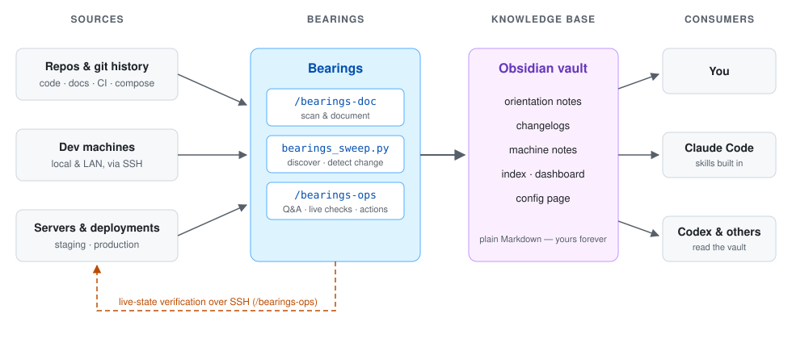

# Bearings

I built Bearings to keep track of my development projects, machines, and deployments. It uses Obsidian and Claude Code to maintain project notes and check live system information.

The goal is simple: when I return to a project months later, I can quickly understand how it works, where it runs, and what changed.

<picture>
  <source media="(prefers-color-scheme: dark)" srcset="assets/architecture-dark.svg">
  
</picture>

## What Bearings does

Bearings writes and keeps notes about your projects, machines, and deployments. The notes are plain Markdown files in an Obsidian vault. The main capabilities are:

- **Project notes.** One note for each project. It covers what the project does, how to start it, how to deploy it, where its configuration is, and its architecture. A "Resume here" section keeps your own text after each refresh.
- **Deployment notes.** One note for each deployment. The facts are properties, so Obsidian Bases shows them as tables by project, machine, or environment.
- **Changelog and archive.** The changelog summarizes the Git history. Before Bearings replaces a fact, it copies the old text to the archive, with the date and the reason.
- **Live checks.** `/bearings-ops` answers questions about the current state. For a question about what runs now, it checks the machine first, over SSH if needed.
- **Scheduled sweeps.** A daily timer finds new and out-of-date notes. You approve new notes on the dashboard. You decide whether refreshes run on their own.
- **Cost tracking.** The dashboard shows the spend and the tokens of each paid run. You can set a monthly warning and a monthly cap.

## How it works

Bearings uses three skills and three scripts:

1. `/bearings-doc` scans one project. It reads the project files, such as `CLAUDE.md`, the README, the deploy files and the manifests. Then it writes the project note, the deployment notes and the changelog. It works on the local machine or over SSH.
2. `scripts/bearings_sweep.py` finds the projects on each machine and compares them with the notes. It writes the dashboard. It starts refreshes only when your settings allow them.
3. `scripts/bearings_lint.py` checks the notes for missing properties, wrong values, broken links and leftover template text. It does not use AI.
4. `/bearings-ops` answers your questions from the notes. For the current state, it runs live commands, such as `docker ps` or `systemctl`.

## Installation and quick start

### Requirements

- [Claude Code](https://claude.com/claude-code)
- Python 3 and Git
- An Obsidian vault. The deployment tables use Obsidian Bases, so use a recent Obsidian version.
- For remote machines: an SSH alias that logs in with a key and does not ask for a password

### Install

```bash
git clone https://github.com/AdarBahar/bearings
cd bearings
./install.sh                 # links the skills into ~/.claude/skills
claude "/bearings-setup"     # asks your settings and writes the first notes
```

`install.sh` links the skills into `~/.claude/skills`. It also writes the path of the repository to `~/.bearings/bearings.env`.

The setup writes a few notes first. You can examine them before Bearings writes the notes for all projects. The daily timer is optional.

## Daily use

```bash
claude "/bearings-doc"                        # write or refresh the note of the current project
claude "/bearings-ops <question>"             # ask about your projects or machines
python3 scripts/bearings_sweep.py --report    # list new and out-of-date notes only (no cost)
python3 scripts/bearings_sweep.py --force     # run a sweep now
python3 scripts/bearings_lint.py              # check all notes (no cost, no AI)
scripts/install-schedule.sh --uninstall       # remove the timer
```

Example questions:

```bash
claude "/bearings-ops how do I run project-a locally?"
claude "/bearings-ops which projects use the shared Postgres server?"
claude "/bearings-ops what is running on my server now?"
```

If you ask how to do something, Bearings gives you the steps. If you ask it to do something ("restart project-a"), it does that action. For staging and production, it asks you to confirm the exact command first.

## Configuration

The settings are the frontmatter of `_Config.md` in the vault. Edit them in Obsidian. The next sweep reads them. You do not need to install Bearings again.

```yaml
---
cadence: weekly-monday        # daily | weekly-<weekday> | manual
refresh_mode: report-only     # report-only | auto
create_new: ask               # ask | auto | never
model:                        # model for headless runs (empty = CLI default)
budget_alert_usd: 0           # monthly cost warning (0 = off)
budget_stop_usd: 0            # monthly cap: skip new paid runs at or above this (0 = off)
notify: off                   # email after a sweep: off | on-action | always
notify_email:                 # where the sweep email goes

machines:
  - "mac | local | ~/Code"
  - "linux-laptop | ssh=linux | ~/Code"

include: ["*"]                # project folders to track
exclude: ["tmp-*"]            # exclude has priority; "linux-laptop:tmp-*" applies to one machine

owners:                       # GitHub users or organizations whose repositories are yours
  - your-github-username

aliases:                      # one note for a folder with a different name
  - "old-directory-name = project-name"
---
```

- **`refresh_mode`:** Finding out-of-date notes costs nothing. Refreshing a note uses Claude usage. With `report-only` (the default), the sweep only lists the out-of-date notes. With `auto`, it runs `/bearings-doc` for them.
- **`model`:** The model for the headless runs, for example a small model such as `claude-haiku-5-5`. A note refresh is mechanical work, so a smaller model lowers the cost. Empty uses the CLI default.
- **Skill canary:** Before the first refresh or creation in a sweep, Bearings runs `/bearings-doc --canary` once, on the configured `model`. The skill answers with a fixed token. This shows that headless runs load the skill. If a future Claude Code release makes bare mode the default for `-p`, the token does not appear. The sweep then skips its runs, keeps the dashboard approvals as checked boxes, and puts a warning on the dashboard.
- **`create_new`:** What to do with a new project. `ask` puts a checkbox on the dashboard. `auto` writes the note at once. `never` ignores the project.
- **`budget_stop_usd`:** A cap. `budget_alert_usd` only warns. When the month's recorded cost reaches the cap, the sweep skips the refreshes and the creations until the next month. Approvals stay checked on the dashboard. The free parts (scan, report, lint) continue. The sweep checks the cap before each paid run, so a run that already started finishes, even if it passes the cap.
- **`notify` / `notify_email`:** An email report after a sweep. `on-action` sends one only when the sweep spent usage or reached the budget stop. `always` sends one after every executed sweep. The SMTP settings are local to the machine, in `~/.bearings/bearings.env`: `BEARINGS_SMTP_HOST`, `BEARINGS_SMTP_PORT` (default 587; 465 uses SSL), `BEARINGS_SMTP_USER`, `BEARINGS_SMTP_PASS` and `BEARINGS_SMTP_FROM` (default: the user). If a notification fails, the dashboard shows a warning. The sweep continues.
- **Folders without Git:** Bearings tracks them only if an include pattern names them, or if they already have a note.
- **Remote machines:** Each sweep finds the projects over SSH. A headless Claude run can use SSH only if you allow it during the setup. The setting is in `~/.bearings/bearings.env`.

## Security

Bearings limits what it reads and writes. The limits have a scope. Read this section before you rely on them.

- **No secret values in the notes.** The notes hold the names of the variables and the locations of the files, not the values. The skill tells the model not to read `.env` files. No check scans the note text for secret values. The vault syncs to other devices, so treat it as semi-public.
- **The `.env` rule in scheduled runs.** Headless runs from the sweep have deny rules for `.env` files, key files, certificates and `secrets/` folders. A `PreToolUse` hook blocks the `.env` family in the file tools. Only the template names (`.env.example`, `.env.sample`, `.env.dist`, `.env.template`) stay readable. An interactive `/bearings-doc` run has neither the deny rules nor the hook. If you allow SSH, a headless run can run any command on the remote machine. The hook does not check shell commands, so the `.env` rule does not cover them.
- **A linter checks the notes, not the model.** `bearings_lint.py` does not use AI. It checks required properties, allowed values, links and leftover template text. Each sweep runs it and shows the problems on the dashboard. In headless runs, a hook lints each note after the edit, and the model fixes the note in the same run.
- **Repositories you do not own.** A repository that is not in `owners` gets a note in the vault only. Bearings does not change its files.
- **Your own repositories.** For each owned local repository, `/bearings-doc` adds a pointer line to `CLAUDE.md`. It also adds the line to `AGENTS.md` if that file exists. The change is not committed. Other agents use the pointer to find the note.
- **Actions only on request.** A question gets an answer. An instruction gets an action. Staging and production need your confirmation.
- **Only you start the note generator.** `bearings-doc` sets `disable-model-invocation: true`. You, the sweep and `claude -p` can start it. A model cannot start it as a side effect of another task.
- **Limited tools for headless runs.** A scheduled run can read and write the vault notes, run `ls`, and use Git only through `scripts/git_ro.py`. Bare `git` has an explicit deny rule, because Claude Code allows read-only commands without asking, and bare `git` follows the repository configuration. The wrapper checks the subcommand and every argument. It blocks the forms that write files (`git log --output=…`), read arbitrary files (`git diff --no-index`, `git grep`) or change refs and remotes. SSH is available only if you allowed it.
- **A run cannot change its own settings.** Headless runs cannot write to the Bearings repository, to `~/.bearings`, to `.git/` folders, or to `_Config.md`, `_Dashboard.md` and `_templates/` in the vault. So a run cannot change its own hook, settings, vault pointer, refresh mode, approvals or templates. The sweep also checks this outside the model. It takes a byte snapshot of the guarded vault files before the runs, and it restores any change after them. The deny rules cover the file tools. They are defense in depth, not an operating system sandbox.
- **Costs appear on the dashboard.** The dashboard shows the tokens and the cost of each paid run, with a monthly total. The cost comes from the Claude CLI result of each run.

## Detailed documentation and repository structure

### Skills and scripts

| Item | Type | Function |
|---|---|---|
| `/bearings-setup` | skill | Sets up Bearings: finds your vault, code folders and SSH hosts, asks your settings, and writes the first notes |
| `/bearings-doc` | skill | Writes or refreshes the note and the changelog of one project, on this machine or over SSH |
| `/bearings-ops` | skill | Answers questions about your projects and machines. For questions about the current state, it checks live first |
| `scripts/bearings_sweep.py` | script | Finds new and out-of-date projects, writes the dashboard and can start refreshes |
| `scripts/bearings_lint.py` | script | Checks the notes: required properties, allowed values, links, leftover template text. It does not use AI |
| `scripts/install-schedule.sh` | script | Installs or removes the daily timer (launchd, systemd or cron) |

### What you get in the vault

```text
Bearings/
├── _Config.md          ← your settings (edit in Obsidian)
├── _Dashboard.md       ← sweep results, costs, approvals
├── _Index.md           ← one row for each project
├── _Deployments.base   ← tables of all deployments (Obsidian Bases)
├── _templates/         ← the note templates
├── project-a/
│   ├── project-a.md        ← the current state: resume here, quick start,
│   │                          deploy process, configuration, architecture
│   ├── project-a@prod.md   ← one note for each deployment
│   ├── changelog.md        ← code changes, from Git
│   └── archive.md          ← old facts, ops events, done items
└── linux-laptop/
    └── linux-laptop.md ← a machine note
```

- **Project note:** The current state of the project: what it does, how to start it, how to deploy it, where its configuration is, its dependencies and its architecture. Text that you write in the "Resume here" section stays after each refresh.
- **Deployment note:** One deployment: host, URLs, paths, user, process, port, database, deploy method, and the date of the last live check. The facts are properties, so the Base shows them as tables for each project, machine or environment.
- **Changelog:** A summary of the Git history. Each refresh adds the new changes.
- **Archive:** The history of the notes. Before Bearings replaces a fact, it copies the old text here with the date and the reason.
- **Machine note:** The facts of one machine. It lists the deployments on the machine from the Base. Hosts that are not your machines also get a machine note: `Stores` (app store listings), `GitHub` (Pages and scheduled Actions) and `Testing` (services on servers that are not yours).
- **Dashboard:** The result of each sweep. New projects show as checkboxes. Tick one to approve its note. A Costs section counts the runs and the spend for today, the last 7 days and this month. It also shows a per-day table for the last week, a per-model table for the last 30 days, and the monthly history. The model table uses the CLI's own per-model usage, so subagent models count. The tables split fresh input tokens from prompt-cache reads, because a cache read costs less than a fresh input token.
- **Group:** You can put related projects one level down under a parent project, for example `my-app/api/api.md`. Bearings finds them there.

The notes help you find your way. They do not replace the documentation in the repository.

### Repository contents

```text
skills/bearings-setup/         setup and settings
skills/bearings-doc/           project scan → note and changelog (local and SSH)
skills/bearings-ops/           questions, live checks, actions with confirmation
scripts/bearings_sweep.py      discovery, out-of-date check, approvals, dashboard, cost
scripts/bearings_lint.py       deterministic note checks (properties, values, links, template text)
scripts/lint_hook.py           PostToolUse hook: lints a note after each headless edit
scripts/secret_guard.py        PreToolUse hook: blocks the .env family before a tool runs
scripts/git_ro.py              read-only git wrapper for headless runs (vetted subcommands and flags)
scripts/install-schedule.sh    daily timer: launchd (macOS), systemd user timer (Linux), or cron
config/headless-settings.json  hook configuration for headless runs (the sweep passes it with --settings)
templates/                     _Config.md, _Dashboard.md, _Deployments.base and the note templates
assets/                        architecture diagram (light and dark)
install.sh                     links the skills into ~/.claude/skills
```

The daily timer does not always start a refresh. The `cadence` and `refresh_mode` settings decide what each sweep does.

Tests run in CI. The CI workflow runs the Python syntax check, the unit tests in `tests/`, and Shellcheck on the shell scripts.

## License

MIT. See [LICENSE](LICENSE).
