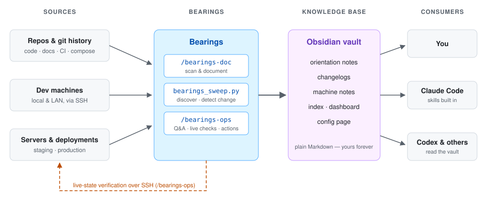

# Bearings

**A second brain for your development environment.**

## Purpose

Bearings keeps a set of notes about your projects, machines and deployments in your Obsidian vault.
Each note tells you how a project is built, how to run it, where it runs, and what changed recently.

The goal: you come back to a project after three months, and in five minutes you know how it works and where everything is.

<picture>
  <source media="(prefers-color-scheme: dark)" srcset="assets/architecture-dark.svg">
  
</picture>

## Benefits

- **No lost knowledge.** Information that was only in your memory or shell history is now in a note: ports, databases, SSH hosts, deploy steps.
- **Notes that stay current.** A scheduled sweep (daily or weekly) finds the notes that are out of date and can refresh them.
- **Better coding agents.** Claude Code reads the notes through the Bearings skills. Other agents find them through a pointer in `CLAUDE.md` or `AGENTS.md`.
- **Answers in plain English.** Ask "what runs on my server?" and Bearings checks the live state before it answers.
- **No secrets in the notes.** The notes contain the names of the variables, never their values.
- **Cost control.** The dashboard shows the token use and cost of each run, with a monthly total.

## Index of skills and tools

| Item | Type | Function |
|---|---|---|
| `/bearings-setup` | skill | Sets up Bearings: finds your vault, code folders and SSH hosts, asks your settings, and writes the first notes |
| `/bearings-doc` | skill | Writes or refreshes the note and the changelog of one project, on this machine or over SSH |
| `/bearings-ops` | skill | Answers questions about your projects and machines. For questions about the current state, it does live checks first |
| `scripts/bearings_sweep.py` | script | Finds new and out-of-date projects, writes the dashboard and can start refreshes |
| `scripts/bearings_lint.py` | script | Checks the notes: required properties, allowed values, links, leftover template text. No AI inside |
| `scripts/install-schedule.sh` | script | Installs or removes the daily timer (launchd, systemd or cron) |

## How to use

### Requirements

- [Claude Code](https://claude.com/claude-code)
- Python 3 and Git
- An Obsidian vault
- For remote machines: an SSH alias that logs in with a key, without a prompt

### Install

```bash
git clone https://github.com/AdarBahar/bearings
cd bearings
./install.sh                 # links the skills into ~/.claude/skills
claude "/bearings-setup"     # asks your settings and writes the first notes
```

The setup writes a few notes first, so that you can examine them before it does all the projects.
The daily timer is optional.

### Daily use

```bash
claude "/bearings-doc"                        # write or refresh the note of the current project
claude "/bearings-ops <question>"             # ask about your projects or machines
python3 scripts/bearings_sweep.py --report    # find new and out-of-date notes only (no cost)
python3 scripts/bearings_sweep.py --force     # run a sweep now
python3 scripts/bearings_lint.py              # check all notes (no cost, no AI)
scripts/install-schedule.sh --uninstall       # remove the timer
```

Example questions:

```bash
claude "/bearings-ops how do I run project-a locally?"
claude "/bearings-ops which projects use the shared Postgres server?"
claude "/bearings-ops what is running on my server now?"
```

If you ask how to do something, Bearings tells you the steps. If you ask it to do something ("restart project-a"), it does it. For staging and production, it asks you to confirm the exact command first.

## What you get

```text
Bearings/
├── _Config.md          ← your settings (edit in Obsidian)
├── _Dashboard.md       ← sweep results, costs, approvals
├── _Index.md           ← one row for each project
├── _Deployments.base   ← tables of all deployments (Obsidian Bases)
├── _templates/         ← the note templates
├── project-a/
│   ├── project-a.md        ← the current state: resume here, quick start,
│   │                          deploy process, configuration, architecture
│   ├── project-a@prod.md   ← one note for each running deployment
│   ├── changelog.md        ← code changes, from Git
│   └── archive.md          ← old facts, ops events, done items
└── linux-laptop/
    └── linux-laptop.md ← a machine note
```

- **Project note:** the current state of the project: what it does, how to start it, how to deploy it, where its configuration is, its dependencies and its architecture. Text that you write in the "Resume here" section stays after each refresh.
- **Deployment note:** one running instance: host, URLs, paths, user, process, port, database, deploy method, and the date of the last live check. The facts are properties, so the Base can show them as tables for each project, machine or env.
- **Changelog:** a summary of the Git history. Each refresh adds the new changes.
- **Archive:** the history of the notes. Before Bearings replaces a fact, it copies the old text here with the date and the reason.
- **Machine note:** the facts of one machine. It shows the deployments on the machine from the Base. Hosts that are not your machines also get a machine note: `Stores` (app store listings), `GitHub` (Pages and scheduled Actions) and `Testing` (services on servers that are not yours).
- **Dashboard:** the result of each sweep. New projects show as checkboxes. Tick one to approve its note.
- **Group:** you can put related projects one level down under a parent project, for example `my-app/api/api.md`. Bearings finds them there.

The notes help you find your way. They do not replace the documentation in the repository.

## Settings

The settings are the frontmatter of `_Config.md` in the vault. Edit them in Obsidian. The next sweep reads them. You do not have to install again.

```yaml
---
cadence: weekly-monday        # daily | weekly-<weekday> | manual
refresh_mode: report-only     # report-only | auto
create_new: ask               # ask | auto | never
model:                        # model for headless runs (empty = CLI default)
budget_alert_usd: 0           # monthly cost warning (0 = off)

machines:
  - "mac | local | ~/Code"
  - "linux-laptop | ssh=linux | ~/Code"

include: ["*"]                # project folders to track
exclude: ["tmp-*"]            # exclude has priority; "linux-laptop:tmp-*" applies to one machine

owners:                       # GitHub users or organizations whose repositories are yours
  - your-github-username

aliases:                      # one note for a folder with a different name
  - "old-directory-name = project-name"
---
```

- **`refresh_mode`:** to find out-of-date notes costs nothing. To refresh a note uses Claude tokens. With `report-only` (the default), the sweep only lists the out-of-date notes. With `auto`, it runs `/bearings-doc` for them.
- **`model`:** the model for the headless runs, for example a small model such as `claude-haiku-5-5`. A note refresh is mechanical work, so a smaller model cuts the cost. Empty uses the CLI default.
- **Skill canary:** before the first run of a sweep, one cheap prompt proves that headless runs load the `bearings-doc` skill. If a future Claude Code release makes bare mode the default for `-p`, the sweep skips its runs and puts a loud warning on the dashboard instead of silently refreshing nothing.
- **`create_new`:** what to do with a new project. `ask` puts a checkbox on the dashboard. `auto` writes the note immediately. `never` ignores it.
- **Folders without Git:** Bearings tracks them only if an include pattern names them, or if they already have a note.
- **Remote machines:** each sweep finds the projects over SSH. A headless Claude run can use SSH only if you allow it during the setup. This setting is in `~/.bearings/bearings.env`.

## Security

- **No secret values.** The notes contain the names of the variables and where the files are. `/bearings-doc` does not read `.env` files. The vault syncs to other devices, so treat it as semi-public.
- **The `.env` rule is enforced, not only requested.** Headless runs get permission deny rules for `.env` files, key files, certificates and `secrets/` folders, and a `PreToolUse` hook blocks the whole `.env` family before a tool runs. Only the secret-free template names (`.env.example`, `.env.sample`, `.env.dist`, `.env.template`) stay readable. A prompt instruction alone is a suggestion; these rules are keys.
- **A linter checks the notes, not the model.** `bearings_lint.py` has no AI inside. It checks required properties, allowed values, links and leftover template text. Each sweep runs it and puts the problems on the dashboard. In headless runs, a hook lints each note directly after the edit, and the model fixes the note in the same run.
- **No changes to other people's repositories.** A repository that is not in `owners` gets a note in the vault only. Bearings does not change its files.
- **Actions only on request.** A question gets an answer. An instruction gets an action. Staging and production need your confirmation.
- **Small permissions for headless runs.** A scheduled run can read and write the vault notes, use `ls`, and use git only through `scripts/git_ro.py`. Bare `git` has an explicit deny rule, because Claude Code auto-allows read-only commands and bare git obeys the repo configuration. The wrapper vets the subcommand and every argument, so forms that write files (`git log --output=…`), read arbitrary files (`git diff --no-index`, `git grep`) or change refs and remotes are blocked. SSH is available only if you allowed it.
- **A run cannot raise its own permissions.** Headless runs cannot write to the bearings repo, to `~/.bearings`, to `.git/` folders, or to `_Config.md`, `_Dashboard.md` and `_templates/` in the vault. So a run cannot change its own hook, settings, vault pointer, refresh mode, approvals or templates. The sweep also enforces this outside the model: it takes a byte snapshot of the guarded vault files before the runs, and it restores any change after them. The deny rules cover the file tools; they are defense in depth, not an OS sandbox.
- **No hidden cost.** The dashboard shows the tokens and the cost of each automatic run, with a monthly total and an optional warning.

## Repository contents

```text
skills/bearings-setup/       setup and settings
skills/bearings-doc/         project scan → note and changelog (local and SSH)
skills/bearings-ops/         questions, live checks, actions with confirmation
scripts/bearings_sweep.py    discovery, out-of-date check, approvals, dashboard, cost
scripts/bearings_lint.py     deterministic note checks (properties, values, links, template text)
scripts/lint_hook.py         PostToolUse hook: lints a note after each headless edit
scripts/install-schedule.sh  daily timer: launchd (macOS), systemd user timer (Linux), or cron
config/headless-settings.json  hook configuration for headless runs (the sweep passes it with --settings)
templates/                   _Config.md, _Dashboard.md, _Deployments.base and the note templates
assets/                      architecture diagram (light and dark)
install.sh                   links the skills into ~/.claude/skills
```

The daily timer does not always start a refresh. The `cadence` and `refresh_mode` settings decide what each sweep does.

## License

MIT
